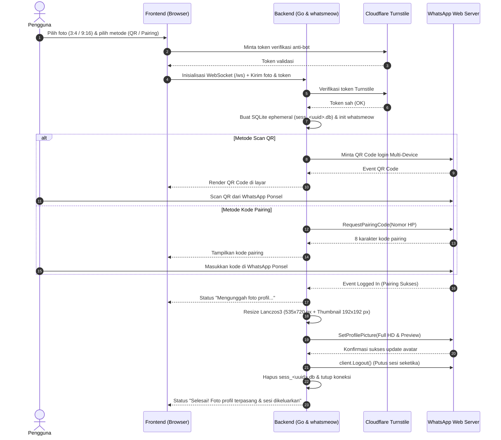

# WhatsApp Full Profile Picture (No Crop HD)

Aplikasi web modern berbasis Go dan Vanilla Web Components untuk memasang foto profil WhatsApp dalam resolusi penuh tanpa terpotong (No Crop), aman, dan mengutamakan privasi pengguna.

---

## Daftar Isi

1. [Latar Belakang & Masalah](#latar-belakang--masalah)
2. [Solusi Teknis](#solusi-teknis)
3. [Arsitektur Keamanan & Privasi (Zero Retention)](#arsitektur-keamanan--privasi-zero-retention)
4. [Alur Kerja Sistem (Sequence Diagram)](#alur-kerja-sistem-sequence-diagram)
5. [Desain Antarmuka (Neubrutalism System)](#desain-antarmuka-neubrutalism-system)
6. [Opsi Deployment](#opsi-deployment)
   - [Opsi 1: Deploy Backend ke Hugging Face Spaces](#opsi-1-deploy-backend-ke-hugging-face-spaces)
   - [Opsi 2: Deploy Frontend ke Vercel](#opsi-2-deploy-frontend-ke-vercel)
   - [Opsi 3: Menjalankan di Komputer Lokal](#opsi-3-menjalankan-di-komputer-lokal)
   - [Opsi 4: Menjalankan dengan Docker](#opsi-4-menjalankan-dengan-docker)
7. [Variabel Lingkungan (Environment Variables)](#variabel-lingkungan-environment-variables)
8. [Struktur Proyek](#struktur-proyek)
9. [Pengujian & Verifikasi](#pengujian--verifikasi)
10. [Lisensi & Atribusi](#lisensi--atribusi)

---

## Latar Belakang & Masalah

Secara bawaan, aplikasi resmi WhatsApp di ponsel cerdas (Android & iOS) membatasi pengunggahan foto profil ke dalam jendela crop berbentuk persegi dengan rasio aspek **1:1**.

Keterbatasan ini menimbulkan sejumlah kendala umum:
* **Foto Vertikal Terpotong**: Foto portrait berorientasi tegak (rasio 3:4 atau 9:16), foto wisuda, foto produk penuh, hingga poster acara terpaksa dipotong sebagian. Area kepala atau bagian bawah badan kerap hilang dari frame.
* **Solusi Manual yang Buruk**: Banyak pengguna terpaksa menggunakan aplikasi editor foto tambahan untuk menambahkan bingkai (border) hitam atau putih di sisi kiri dan kanan agar foto menjadi persegi. Akibatnya, subjek foto tampak mengecil dan tidak profesional.
* **Kebutuhan Format Utuh**: Tampilan detail kontak WhatsApp sebenarnya mampu menampilkan avatar berukuran penuh ketika pengguna lain mengetuk foto profil untuk melihatnya secara utuh. Namun antarmuka crop di aplikasi ponsel tidak mengizinkan bypass rasio 1:1 tersebut secara langsung.

---

## Solusi Teknis

Proyek ini mengatasi batasan antarmuka aplikasi seluler dengan memanfaatkan **WhatsApp Web Multi-Device Protocol** melalui pustaka open-source [whatsmeow](https://github.com/tulir/whatsmeow):

1. **Pemrosesan Citra Cerdas (Smart Image Pipeline)**:
   - Server menerima unggahan foto (format JPG, PNG, atau WEBP).
   - Membaca dan menormalisasi orientasi EXIF secara otomatis agar foto tidak terbalik.
   - Melakukan scaling cerdas menggunakan filter interpolasi **Lanczos3** (via `github.com/disintegration/imaging`) ke resolusi vertikal optimal: **535x720 px**.
   - Menghasilkan dua payload citra:
     - **Full Avatar**: 535x720 px (JPEG kualitas tinggi) untuk tampilan layar penuh saat profil dibuka.
     - **Thumbnail Preview**: 192x192 px (JPEG ringkas) untuk tampilan lingkaran mini pada daftar obrolan.

2. **Dukungan Dua Metode Penautan**:
   - **Scan Kode QR**: Memindai QR dinamis yang di-render secara visual di browser via koneksi WebSocket real-time.
   - **Kode Pairing (Nomor HP)**: Memasukkan nomor telepon untuk menerima 8 karakter kode pairing langsung ke aplikasi WhatsApp di ponsel.

3. **Injeksi Avatar Resmi**:
   - Setelah perangkat tertaut via protokol multi-device, server memanggil API `SetProfilePicture` WhatsApp dengan payload avatar vertikal yang telah disiapkan.
   - Foto profil berhasil diperbarui seketika di server WhatsApp tanpa terkena pemotongan paksa 1:1.

---

## Arsitektur Keamanan & Privasi (Zero Retention)

Menautkan akun WhatsApp ke aplikasi web pihak ketiga membutuhkan jaminan keamanan tingkat tinggi. Aplikasi ini dibangun dari nol dengan mematuhi prinsip **Ephemeral & Zero Retention Architecture**:

* **Sesi Bersifat Sementara (Ephemeral Database)**:
  Setiap permintaan sesi dibuat dalam wadah basis data SQLite terisolasi dengan nama acak `sess_<uuid>.db`. Tidak ada sesi bersama atau kredensial yang disimpan antar pengguna.
* **Auto-Logout Seketika (Instant Revocation)**:
  Seketika foto profil berhasil terpasang di akun Anda, backend secara otomatis memanggil fungsi resmi `client.Logout()` ke server WhatsApp. Tautan sesi di ponsel Anda langsung terputus (revoked), dan file SQLite sesi segera dihapus permanen dari server.
* **Nol Akses Data Obrolan (Zero Data Retention)**:
  Sistem backend hanya mendaftarkan handler untuk event pembaruan avatar profil. Server sama sekali tidak mengaktifkan listener pesan masuk/keluar, tidak mengunduh daftar kontak, dan tidak menyimpan arsip percakapan apa pun.
* **In-Memory Streaming**:
  File foto diproses langsung di memori RAM dan tidak disimpan sebagai file statis di media penyimpanan server.
* **Proteksi Cloudflare Turnstile**:
  Setiap koneksi WebSocket dilindungi token verifikasi Turnstile untuk menangkal serangan bot, spam pembuatan sesi, dan brute-force pairing.

---

## Alur Kerja Sistem (Sequence Diagram)

Berikut alur komunikasi antara antarmuka pengguna, backend Go, pustaka whatsmeow, dan server resmi WhatsApp:



---

## Desain Antarmuka (Neubrutalism System)

Aplikasi ini menggunakan sistem desain **Neubrutalism** sesuai panduan spesifikasi di [DESIGN.md](file:///c:/Users/Administrator/Documents/PROJECT-GITHUB/ppfull/DESIGN.md):

* **Karakter Visual Kuat**: Garis tepi tegas (`border: 3px solid #121212`), bayangan keras (`box-shadow: 4px 4px 0 #121212`), sudut membulat taktil (8px), dan palet warna kontras tinggi.
* **Tata Letak Desktop Seimbang**: Memanfaatkan CSS Grid 2 kolom pada layar lebar (1200px container) dengan sidebar edukatif di sebelah kiri (kartu info fitur, visual perbandingan rasio, checklist keamanan) dan panel kerja interaktif di sebelah kanan, sehingga ruang desktop terisi rapi tanpa terasa sesak.
* **Responsif Sepenuhnya**: Pada tablet dan ponsel (layar di bawah 992px), kisi otomatis bertransformasi menjadi susunan satu kolom yang ringkas dan nyaman dioperasikan satu tangan tanpa horizontal scroll.
* **Dual Theme**: Tersedia mode Gelap (Dark Mode) dan mode Terang (Light Mode) yang dapat diaktifkan melalui tombol toggle di navbar dengan transisi CSS halus.

---

## Opsi Deployment

Aplikasi ini dirancang fleksibel untuk berbagai lingkungan hosting:

### Opsi 1: Deploy Backend ke Hugging Face Spaces

Repository ini mendukung deployment langsung ke Hugging Face Spaces (bebas biaya, mendukung koneksi WebSocket persisten):

1. Buat Space baru di [huggingface.co/new-space](https://huggingface.co/new-space):
   - **Space Name**: misalnya `wa-full-pfp`
   - **License**: `MIT`
   - **Space SDK**: Pilih **Gradio** (Template: **Blank**) atau **Docker**
   - **Hardware**: CPU basic (Free)
2. Tambahkan git remote dan lakukan push:
   ```bash
   git remote add space https://huggingface.co/spaces/<username>/<space-name>
   git push space main
   ```
3. **Mekanisme Otomatis di Hugging Face (`app.py`)**:
   - Mendeteksi ketersediaan runtime ZeroGPU dan memicu handshake durasi 1 detik secara aman tanpa membebani kuota GPU harian.
   - Mengunduh toolchain Go resmi terbaru dan mengompilasi binary `./server` secara mandiri.
   - Menjalankan background keep-alive thread setiap 5 menit agar Space tidak masuk ke mode sleep.
   - Menjalankan server Go pada port `7860`.
4. URL publik backend Anda akan aktif di:
   ```
   https://<username>-<space-name>.hf.space
   ```

### Opsi 2: Deploy Frontend ke Vercel

Untuk kecepatan CDN global dan kemudahan custom domain, folder `frontend` dapat dideploy ke Vercel:

1. Import repository di [Vercel](https://vercel.com/).
2. Tentukan **Root Directory**: `frontend`.
3. Klik tombol **Deploy**.
4. **Hubungkan Frontend ke Backend**:
   - Buka website Vercel Anda di peramban.
   - Buka dialog **Pengaturan** (ikon gear di navbar kanan atas).
   - Masukkan URL backend Hugging Face Anda (misalnya `https://ilhamdev-wa-full-pfp.hf.space`).
   - Tekan **Simpan**. Status server akan diverifikasi otomatis dan berubah menjadi hijau (Online).

### Opsi 3: Menjalankan di Komputer Lokal

1. Prasyarat: Pastikan Golang versi 1.23 atau lebih baru telah terpasang ([go.dev/dl](https://go.dev/dl/)).
2. Unduh dependensi:
   ```bash
   go mod tidy
   ```
3. Jalankan server:
   ```bash
   go run .
   ```
4. Buka peramban dan akses:
   ```
   http://localhost:7860
   ```

### Opsi 4: Menjalankan dengan Docker

```bash
docker build -t wa-full-pfp .
docker run -p 7860:7860 wa-full-pfp
```

Container menggunakan multi-stage build berbasis Alpine Linux dengan user non-root (UID 1000) demi standar keamanan produksi.

---

## Variabel Lingkungan (Environment Variables)

Aplikasi dapat dikonfigurasi melalui environment variable atau file `.env`:

| Variabel | Tipe | Default | Keterangan |
| :--- | :--- | :--- | :--- |
| `PORT` | Integer | `7860` | Port tempat HTTP & WebSocket server menerima request |
| `TURNSTILE_SECRET_KEY` | String | *(Kosong)* | Secret key Cloudflare Turnstile untuk validasi server |
| `TURNSTILE_SITE_KEY` | String | *(Kosong)* | Site key publik Cloudflare Turnstile untuk frontend |
| `SESSION_TIMEOUT` | Durasi | `3m` | Batas waktu maksimal sebuah sesi menunggu scan QR / pairing |

> **Catatan Pengujian**: Jika `TURNSTILE_SECRET_KEY` tidak diisi (misalnya saat pengujian lokal), backend secara otomatis mengaktifkan mode bypass sehingga pengembang tidak perlu mendaftar domain ke Cloudflare untuk sekadar mencoba fitur.

---

## Struktur Proyek

```
.
|-- Dockerfile              # Container image multi-stage build untuk Hugging Face Docker SDK
|-- app.py                  # Launcher wrapper & keep-alive daemon untuk Hugging Face Gradio SDK
|-- main.go                 # Core server: HTTP router, WebSocket broker, image pipeline, whatsmeow
|-- turnstile_test.go       # Pengujian validasi Cloudflare Turnstile & ekstraksi IP
|-- logout_test.go          # Pengujian penanganan disconnect & auto-logout cleanup sesi
|-- DESIGN.md               # Spesifikasi sistem desain Neubrutalism (Grid, token, komponen)
|-- frontend/               # Berkas statis antarmuka pengguna (HTML5, Vanilla CSS, Vanilla JS)
|   |-- index.html          # Halaman utama dengan Schema.org, Open Graph, & semantic structure
|   |-- 404.html            # Halaman kesalahan 404 bertema Neubrutalism
|   |-- style.css           # Sistem token desain, dark/light theme, & responsive layout
|   |-- app.js              # State machine UI, WebSocket lifecycle, rendering QR, Turnstile widget
|   |-- robots.txt          # Panduan perayapan mesin pencari
|   |-- sitemap.xml         # Peta situs terstruktur SEO
|   `-- site.webmanifest    # Konfigurasi PWA & app icon
`-- README.md               # Dokumentasi teknis & panduan proyek
```

---

## Pengujian & Verifikasi

Proyek ini dilengkapi rangkaian pengujian unit (unit tests) untuk memverifikasi logika sesi dan keamanan:

Jalankan seluruh test:
```bash
go test -v ./...
```

Cakupan pengujian meliputi:
- `TestLogoutSession_NilSafety`: Memastikan pemanggilan logout aman dari panic jika objek nil.
- `TestLogoutSession_DisconnectedClient`: Memastikan sesi terputus dibersihkan secara benar dari memori dan basis data.
- `TestVerifyTurnstileToken_BypassWhenNoSecret`: Memverifikasi mode bypass saat secret key tidak diset.
- `TestVerifyTurnstileToken_FailsOnEmptyTokenWhenSecretSet`: Memastikan permintaan tanpa token ditolak jika secret key aktif.
- `TestConfigEndpoint`: Memverifikasi payload konfigurasi publik `/config`.
- `TestWebSocket_TurnstileRejection`: Memastikan koneksi WebSocket ditolak jika tidak membawa token Turnstile valid.
- `TestGetClientIP`: Memverifikasi ekstraksi alamat IP dari header `CF-Connecting-IP`, `X-Forwarded-For`, dan `RemoteAddr`.

---

## Lisensi & Atribusi

* Kode proyek ini dilisensikan di bawah [MIT License](LICENSE).
* Protokol komunikasi WhatsApp menggunakan [whatsmeow](https://github.com/tulir/whatsmeow) oleh Tulir Asokan.
* Pustaka manipulasi citra menggunakan [imaging](https://github.com/disintegration/imaging) oleh Grigory Bakunov.
* Pustaka WebSocket menggunakan [coder/websocket](https://github.com/coder/websocket).
* **Pemberitahuan**: Alat ini adalah utilitas independen pihak ketiga dan tidak berafiliasi, disponsori, maupun didukung secara resmi oleh WhatsApp LLC atau Meta Platforms, Inc.
